# Web GIS Lab 2: District Explorer

**Submitted To:** Shahid Nawaz  
**Submitted By:** Fatimah Zaheer  
**Reg no:** 537812  
**Subject:** WebGIS

This lab builds a web map of Pakistan's 160 districts. The data was prepared in QGIS, read as text in VS Code, and drawn with Leaflet, with a legend, popups and a province filter.

---

## 1. Project setup (Checkpoint 1)

The project folder is `C:\webgis-lab`, with `index.html`, `style.css`, `app.js` and a `data` folder.

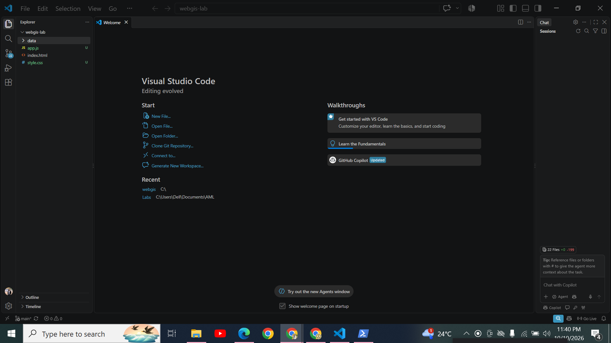

*VS Code opened on `webgis-lab`, showing `app.js`, `index.html`, `style.css` and `data`.*

---

## 2. Data preparation in QGIS (Checkpoint 2)

**The layer.** The district layer has 160 features, is stored as GeoJSON, and uses EPSG:4326 (WGS 84).

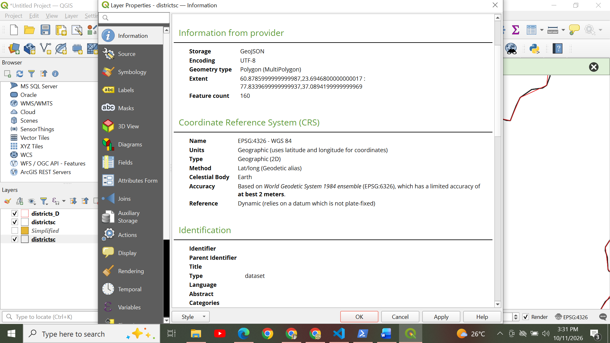

*Layer Properties, Information: 160 features, CRS EPSG:4326 - WGS 84.*

**The fields.** The layer has five fields: `district`, `province`, `pcode`, `pop_2023` and `area_km2`. `pop_2023` is a number, and 25 districts have no value: 10 in Azad Kashmir, 14 in Gilgit Baltistan and 1 in Balochistan (Lehri).

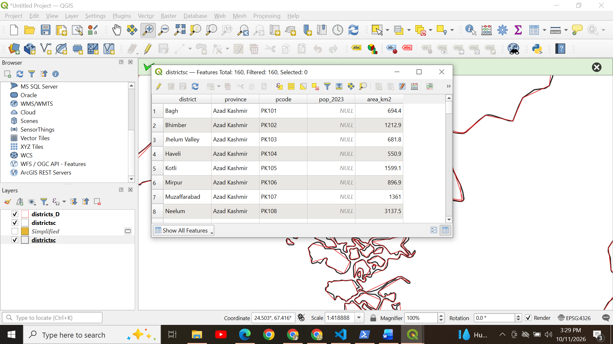

*Attribute table with 160 features. Azad Kashmir districts have `NULL` population.*

**Version A and version D together.** Version A is the brown filled layer and version D is the red outline.

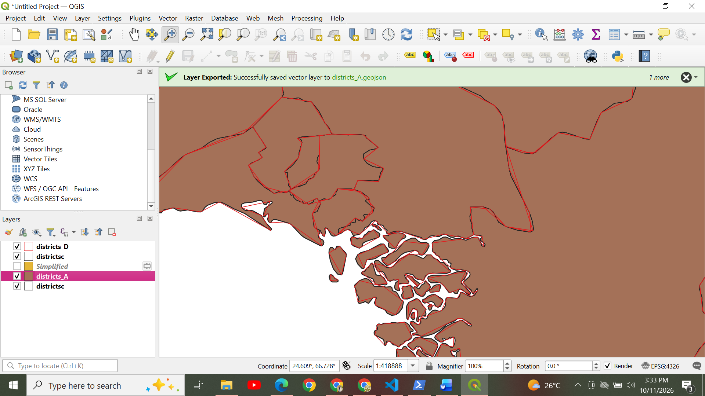

*Version D (red) follows version A (brown) closely but cuts corners.*

**Version D against the simplified layer, zoomed out and zoomed in.**

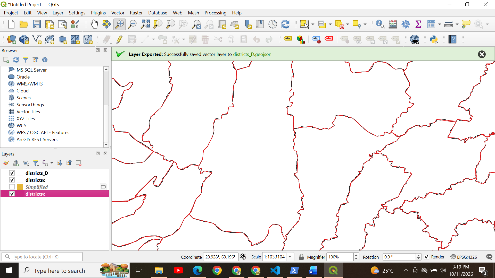

*Scale 1:1,033,104. The outlines almost coincide.*

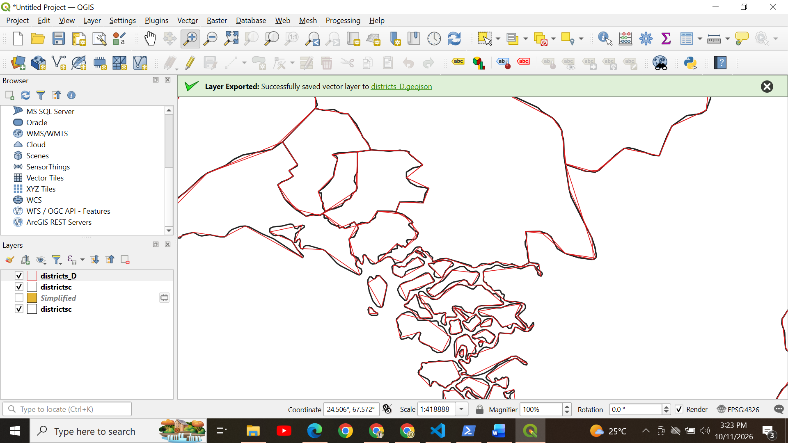

*Scale 1:418,888. Version D (red) replaces curved borders with straight segments, and small districts lose their shape.*

**The exports in QGIS and in the project.**

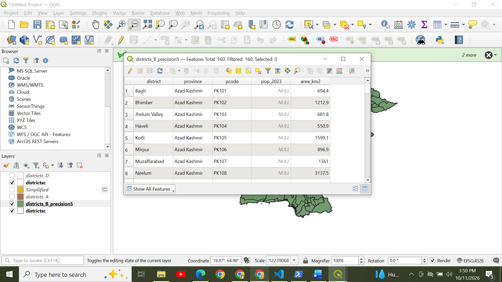

*`districts_B_precision5` loaded in QGIS with 160 features.*

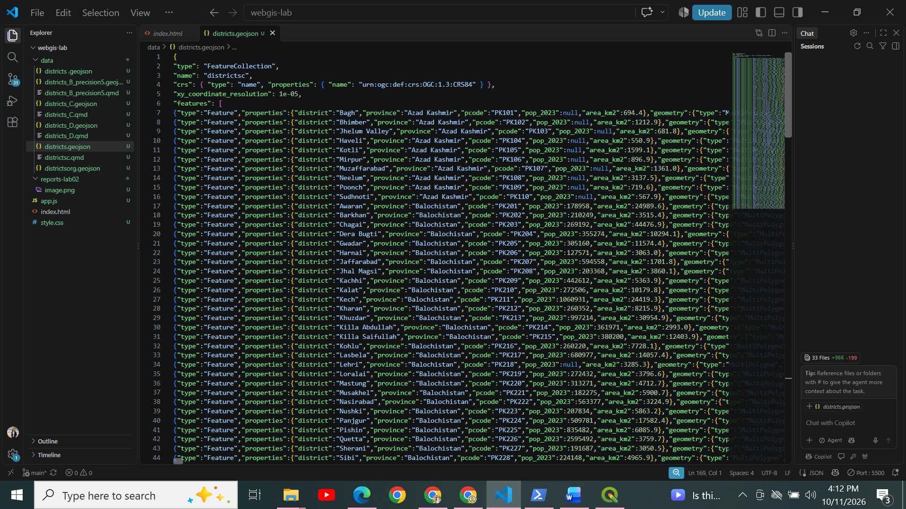

*The `data` folder in VS Code lists the exported versions: B, C and D.*

---

## 3. Reading the data as text (Checkpoint 3)

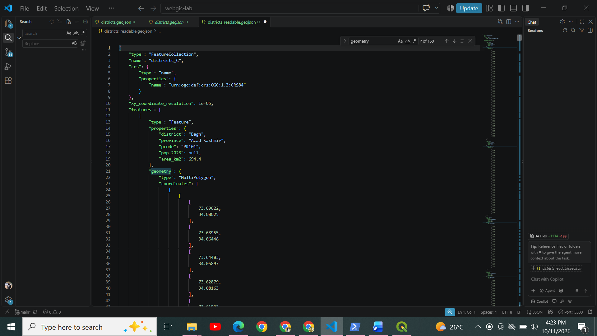

*The formatted GeoJSON. Searching for "geometry" finds 160 matches, one per feature.*

| Question | Answer |
|---|---|
| 1. Type of the outermost object | `FeatureCollection` |
| 2. Entries in `features` | 160 |
| 3. Geometry type of the first feature | `MultiPolygon` |
| 4. Levels of square bracket before the first number | 4 |
| 5. Keys inside `properties` | `district`, `province`, `pcode`, `pop_2023`, `area_km2` |
| First coordinate pair | `[73.69622, 34.08025]` |
| Coordinate order | Correct: longitude first, latitude second |
| Ring closure | Confirmed for the first outer ring |

The first number, 73.69622, is a longitude (Pakistan runs from about 61 to 77) and the second, 34.08025, is a latitude (about 24 to 37). So the order is longitude first, as GeoJSON requires.

---

## 4. The web map (Checkpoints 4, 5, 7 and 8)

The page is served with Live Server at `127.0.0.1:5500`, not opened from the file system.

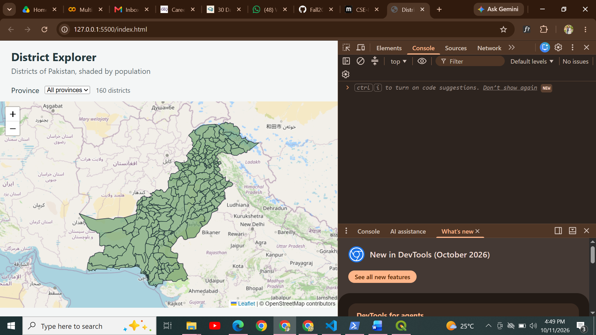

*Checkpoint 4: the header, the province drop-down, the district count and the map, served from `127.0.0.1:5500`.*

**Province filter (Checkpoint 8).** The drop-down is filled from the data, and choosing a province redraws the map and updates the count.

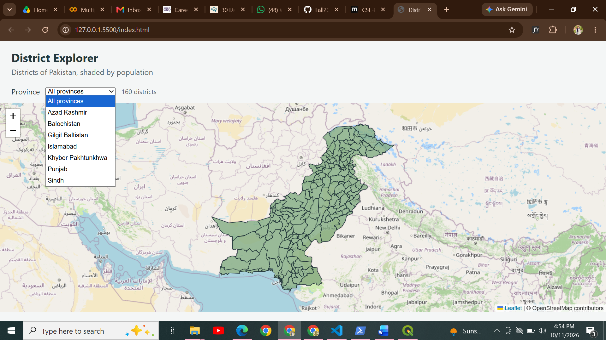

*The drop-down lists the seven provinces and territories.*

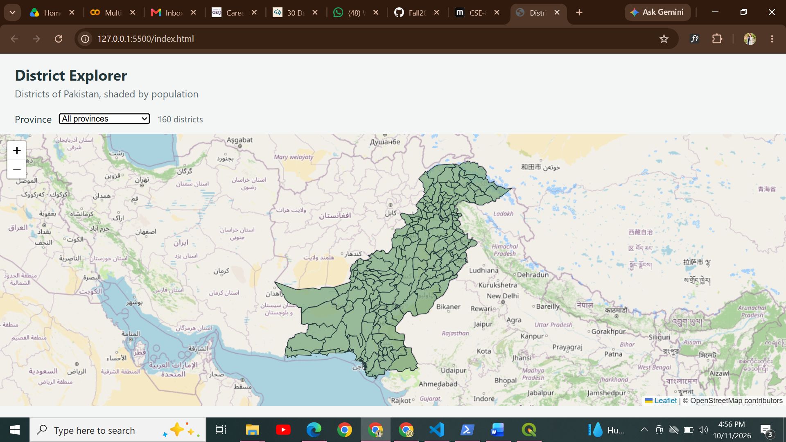

*All provinces selected: 160 districts.*

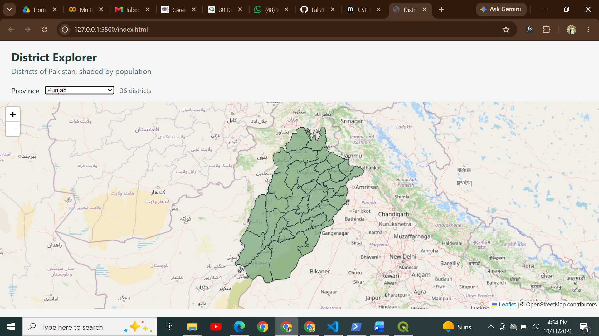

*Punjab selected: 36 districts.*

The district counts are Punjab 36, Balochistan 35, Khyber Pakhtunkhwa 35, Sindh 29, Gilgit Baltistan 14, Azad Kashmir 10 and Islamabad 1, which add up to 160.

**Popup.** Clicking a district shows its province, population and area.

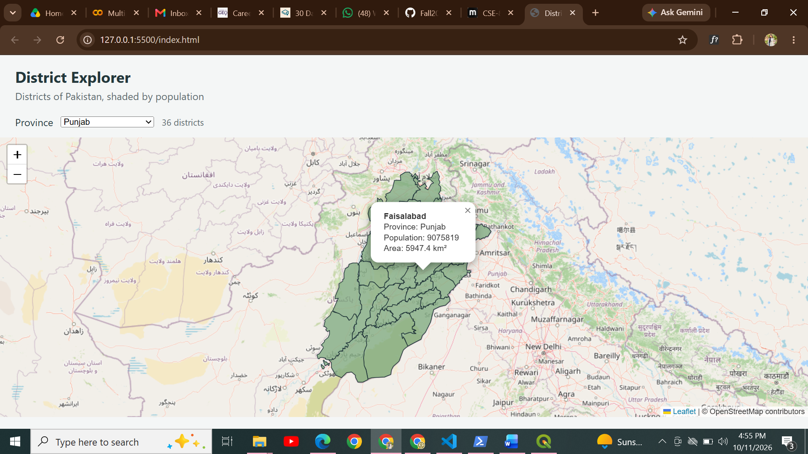

*Faisalabad: Province Punjab, Population 9075819, Area 5947.4 km². These match the data file.*

**Legend and classes.**

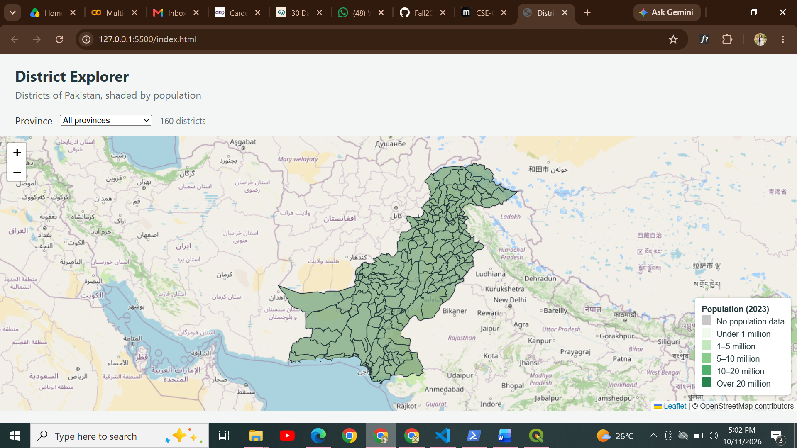

*The legend, "Population (2023)", has six entries: No population data, Under 1 million, 1-5 million, 5-10 million, 10-20 million and Over 20 million.*

**Classification breaks:** 1,000,000, 5,000,000, 10,000,000 and 20,000,000.

---

## 6. Questions

**1. Version D is far smaller than version A. Give one situation in which version D would be the wrong choice.**

Version D would be wrong for measuring, such as computing district areas or perimeters, or for zooming in to one district. Its tolerance of 0.01° is about 1 km, so borders can move by up to a kilometre, areas change, and neighbouring districts no longer fit together.

**2. The page makes one request for your GeoJSON file and dozens for tiles. Explain the difference in how those two kinds of data reach the browser.**

The GeoJSON is one text file that `app.js` requests once with `fetch()`. The browser downloads it whole and Leaflet draws it as vector shapes. The basemap is made of many small 256 × 256 pixel images called tiles. Leaflet requests only the tiles visible on screen and asks for more whenever the map is panned or zoomed.

**3. Why does the map container need a height when the heading does not?**

A heading gets its height from its text. The map container is an empty `div` with no content, so it collapses to zero height unless `style.css` gives it one. Leaflet then has no visible area to draw into, and no error is shown.

**4. `draw` removes the existing layer before adding a new one. What would go wrong if it did not?**

Each call to `draw()` would add a new layer on top of the old one. After choosing Punjab, the map would still show all 160 districts underneath, the fills would stack and look darker, clicks could hit the old shapes, and the map would slow down.

**5. A classmate's districts all appear in the same colour. List two possible causes and how you would tell them apart.**

Cause 1, the data: `pop_2023` may be text, missing, or read under the wrong property name, so every value fails the comparisons and gets the default colour.

Cause 2, the code: the style may be a fixed colour, the colour function may not be passed to Leaflet as a function, or the breaks may put every value in one class.

To tell them apart, run the colour function in the Console with a large and a small number, for example `colourFor(13004135)` and `colourFor(200000)`. Different colours mean the code works and the data is wrong. The same colour means the code or the breaks are wrong.

**6. You open the page by double-clicking index.html instead of using Live Server. The basemap appears but the districts do not. Explain why.**

Double-clicking opens the page from a `file://` address. For security, browsers block `fetch()` from `file://` pages, so the GeoJSON is never loaded. The basemap still appears because tiles are ordinary images from the internet, which are allowed. Live Server serves the page over `http://127.0.0.1:5500`, so the fetch is allowed.

---

## 8. Submission links

| Repository | https://github.com/fatimazaheer602-source/webgis-2025-IGIS-537812
| Live page | https://fatimazaheer602-source.github.io/webgis-2025-IGIS-537812/lab2/
