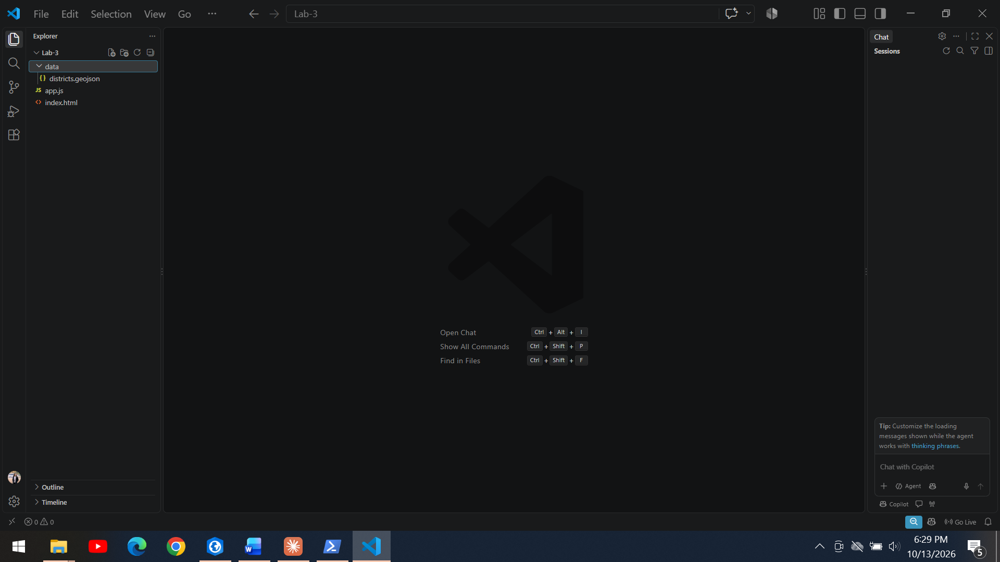
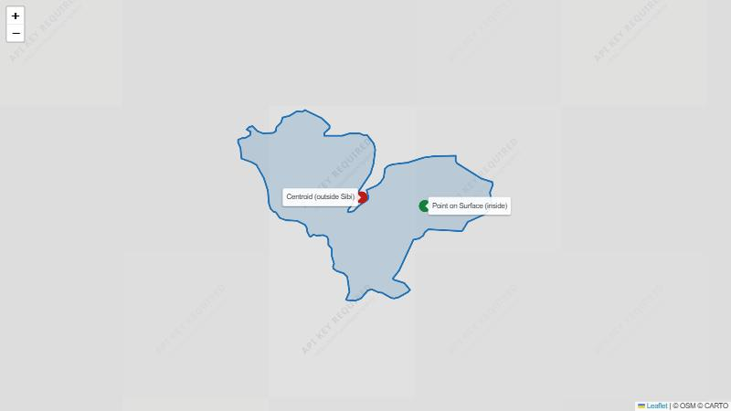
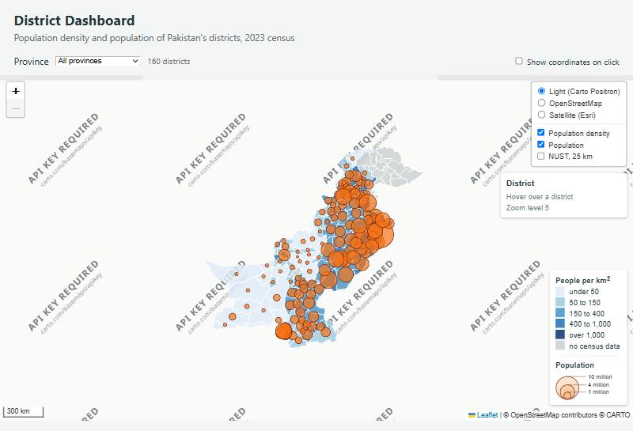
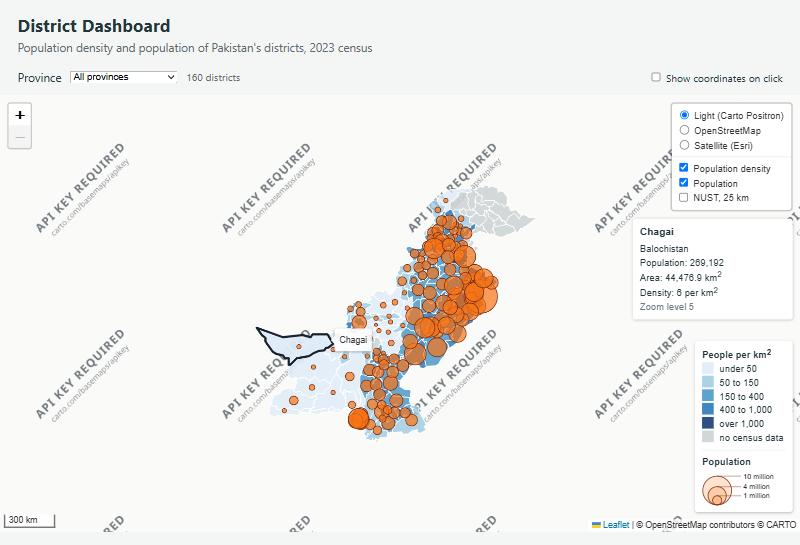
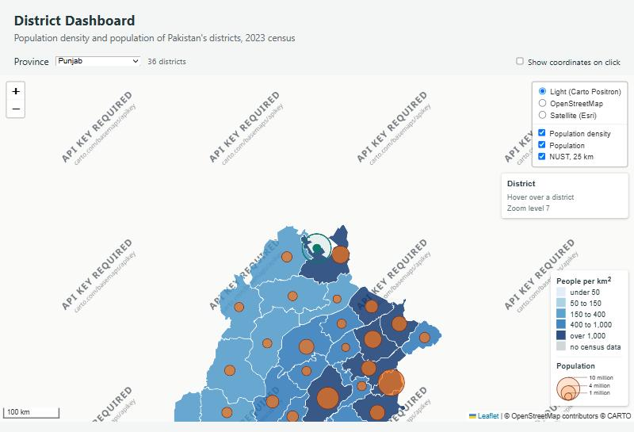
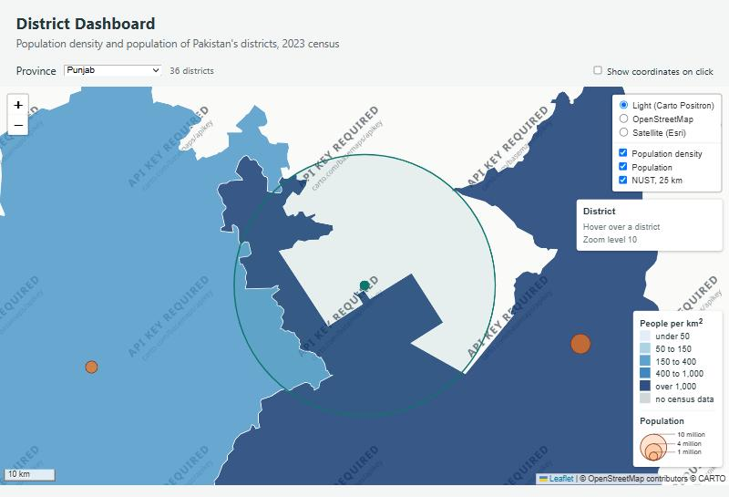
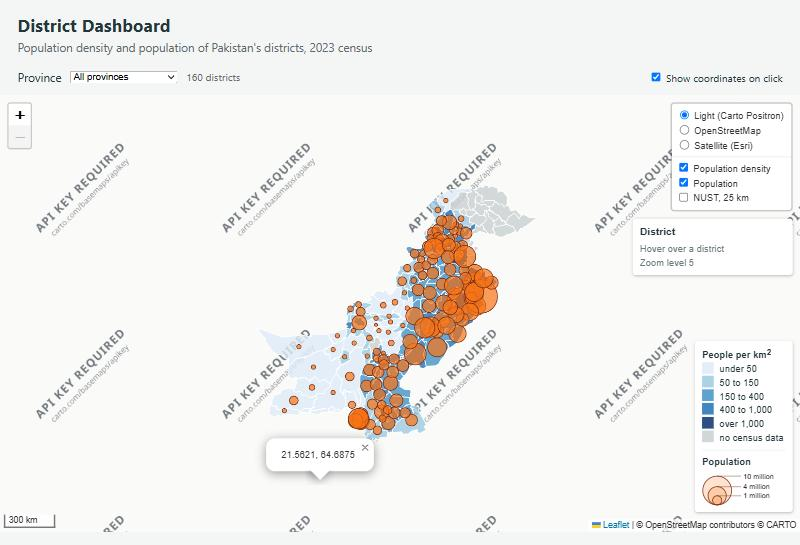
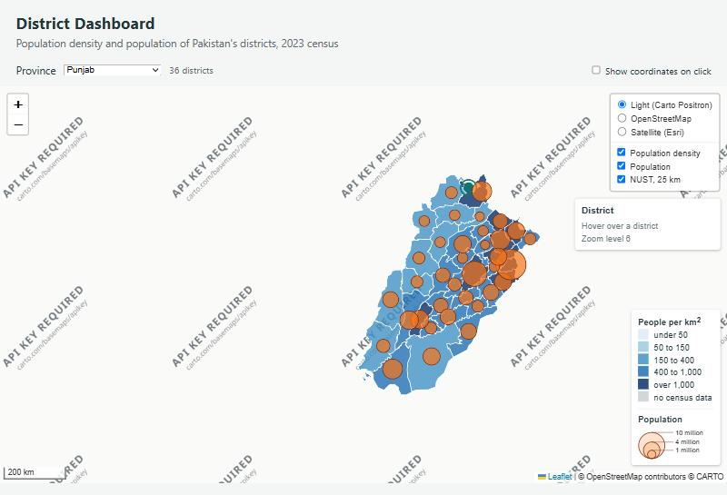
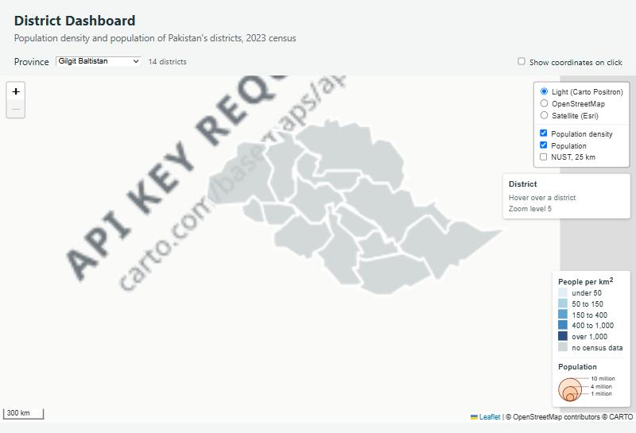

# Web GIS Lab 3: District Dashboard

## 1. Checkpoint screenshots

| # | Screenshot | Note |
|---|---|---|
| 1 |  | VS Code with the project folder |
| 2 |  | Sibi: red = centroid (outside), green = point on surface (inside) |
| 3 | see section 3 | Esri tile URL (below) |
| 4 / 6 |  | Density shading, circles above it, legend with both parts, layer control with 3 basemaps + overlays |
| 5 |  | Chagai highlighted, tooltip, info panel (population, area, density) |
| 6 |   | NUST overlay at zoom 7 and 10 |
| 7 |  | Coordinate popup on the sea |
| 8 |   | Punjab selected, overlays still toggle; Gilgit Baltistan has no circles |

Note: the Carto Positron tiles show an "API KEY REQUIRED" watermark in the test browser used for these screenshots. The code is exactly as in the manual; the watermark comes from Carto's tile server for that environment.

## 2. Point layer

- `data/district_points.geojson`: **31,232 bytes (about 30.5 KB), 160 features**, EPSG:4326, 5 decimal places.
- District whose centroid falls outside its boundary: **Sibi** (Balochistan). Centroid 29.7615, 67.9447 (outside); point on surface 29.7271, 68.2501 (inside).
- Method: computed with Shapely (`centroid` and `representative_point`, the same GEOS routines QGIS uses), because QGIS is not installed on this machine. The same result is expected from QGIS's Centroids and Point on Surface tools.

## 3. Esri tile URL

`https://server.arcgisonline.com/ArcGIS/rest/services/World_Imagery/MapServer/tile/5/12/21`

Template is `{z}/{y}/{x}`, so **5 = zoom, 12 = row (y), 21 = column (x)**. (Captured from the page's resource list; the browser pane has no DevTools Network tab.)

## 4. Part 7 notes

1. Checkbox ticked, click on the sea: a popup shows `21.5621, 64.6875`. Clicking a district: **both** handlers run. The district's handler zooms to it and the click also reaches the map, so a coordinate popup opens too.
2. Click on the legend with `disableClickPropagation` in place: no popup. With the line removed: the click passes through to the map and a coordinate popup appears. Line restored afterwards.
3. Checkbox unticked: `map.listens('click')` is `false`, and clicking the sea does nothing.

## 5. Part 9 table

| | SVG | Canvas |
|---|---|---|
| draw(all), median of five, ms | 57.4 (runs: 57.4, 70.5, 57.2, 67.3, 53.9) | 51.2 (runs: 51.2, 47.1, 45.2, 70.6, 51.8) |
| Elements inside `leaflet-overlay-pane` | 162 (160 `<path>`, one per district) | 1 (a single `<canvas>`) |
| Elements inside `symbols` pane | 137 (135 circle `<path>`) | 1 `<canvas>` |
| Hover highlight still works? | Yes | Yes |
| Can you inspect one district in Elements? | Yes, each is a `<path>` | No, it is pixels on one canvas |

Elements-tab screenshots were not taken (the browser pane has no DevTools). The counts above were read from the DOM.

Expectation for the tehsil layer: several times more features, each with many more vertices. SVG would create thousands of DOM nodes, so memory, style/layout work and pan/zoom would get slow. Canvas stays one element and just repaints, so it should win clearly. The cost is losing per-feature DOM inspection.

## 6. Part 8: Gilgit Baltistan

The count shows 14 districts but no circles. All 14 have no census value (`pop_2023` is null). `hasPopulation` removes them before drawing, so there is nothing to size. They show grey ("no census data") in the legend. The dashboard should say so, for example "No census data for these districts", otherwise users may think the circles failed to load.

## 7. Answers

1. **Large and thinly populated: Chagai** (44,477 km², 269,192 people, 6 per km²). On the Lab 2 population map it would look like a very low, almost empty, district, which hides that it is huge. Its low count mainly reflects the area. **Small and crowded: Central Karachi** (65 km², 3.8 million, about 58,700 per km²). On a population choropleth it would look no heavier than larger, far less dense districts, hiding how extremely crowded it is. Colour should follow density, not count.
2. Without the square root the radius would follow population. Lahore (13 million) against a 3 million district would have a radius about 4.3 times larger and an **area about 19 times larger**, instead of the true ratio of 4.3. Lahore would look far bigger than it is.
3. `districts` is thrown away and rebuilt on every province change, so a control pointing at it would switch off a layer that no longer exists. `districtGroup` stays put and only its contents change.
4. In `overlayPane`, circles and polygons share a z-index, so draw order decides. Hovering calls `bringToFront()`, so the highlighted polygon would jump on top and **hide the circles** inside it (and block their tooltips) while hovered. The `symbols` pane (450) keeps circles above all polygons.
5. `map.off` finds the handler by matching the same function object passed to `map.on`. `showCoordinates` is a named function, so the same reference can be passed to both. An anonymous function has no reference to pass back.
6. **25 km evacuation zone: `L.circle`** (radius in metres). It stays 25 km on the ground and grows as you zoom in (about 394 px wide at zoom 10). **Campus marker on a national map: `L.circleMarker`** (radius in pixels). It stays 6 px at every zoom, so it remains visible nationally instead of shrinking to a dot.

## 8. Not done (needs the user)

Part 10.1 (push and GitHub Pages) needs the user's repository, so it was not run. Commands from the manual: `git add -A`, `git commit -m "Lab 3: district dashboard"`, `git push`.
