# Web GIS Lab 4: Getting started with GeoDjango

**Submitted To:** Shahid Nawaz  
**Submitted By:** Fatimah Zaheer  
**Reg no:** 537812  
**Subject:** WebGIS

This lab moves the 160 districts from Labs 2 and 3 into a PostGIS database. Django serves them as GeoJSON, they can be edited in the Django admin panel, and Leaflet draws them. The project runs only on my own machine, so there is no live page.

---

## 1. Versions on my machine

| Software | Version |
|---|---|
| Python | 3.14.3 |
| pip | 25.3 |
| Django | 6.1.2 |
| psycopg and psycopg-binary | 3.3.6 |
| PostgreSQL | 18.1 |
| PostGIS | 3.6.2 |
| GDAL (used by Django) | 3.13.3 |
| GEOS (used by Django) | 3.15.0 |
| GEOS and PROJ (inside PostGIS) | 3.14.1 and 8.2.1 |

---

## 2. Installation errors and changes

No installation error messages were recorded while doing this lab. Two things differ from the manual:

- **OSGeo4W location.** It is installed at the root of the `F:` drive, not `C:\OSGeo4W`. In `webgis/settings.py` the line is `OSGEO4W = r"F:"`. `F:\bin\gdal313.dll` exists and Django loads GDAL and GEOS correctly (Checkpoint 3).
- **Basemap.** The map page uses the Esri World Light Gray basemap instead of OpenStreetMap, so the coloured provinces stand out.

The database password is read from the environment variable `WEBGIS_DB_PASSWORD`, so it is not in the code.

---

## 3. Python and a first Django project (Checkpoint 1)

Python 3.14.3 was already installed. A virtual environment was created, Django 6.1.2 was installed with `psycopg[binary]`, and the project and app were created.

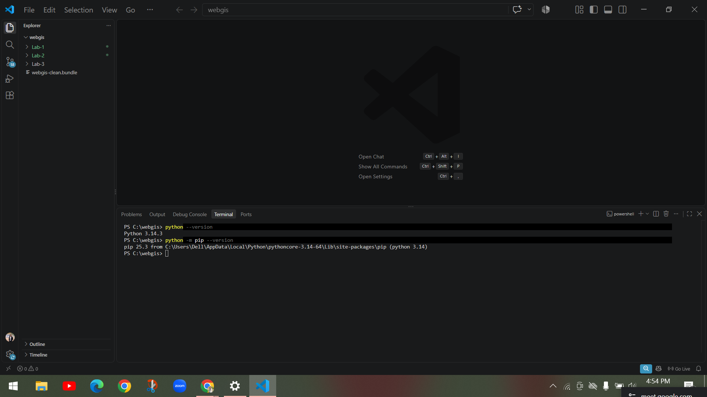

*`python --version` prints 3.14.3 and `pip` belongs to Python 3.14.*

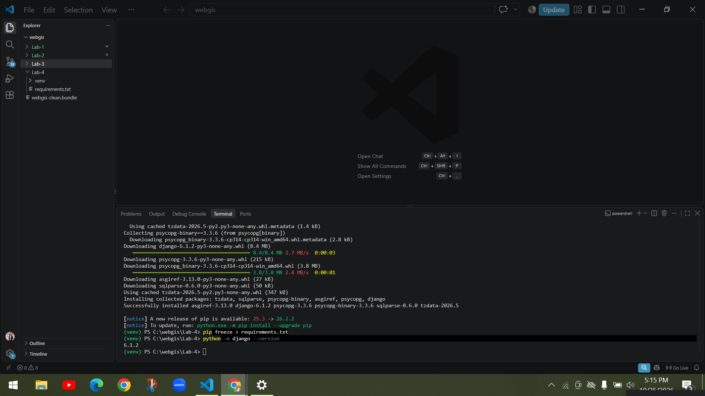

*Packages installed into the venv. `python -m django --version` prints 6.1.2.*

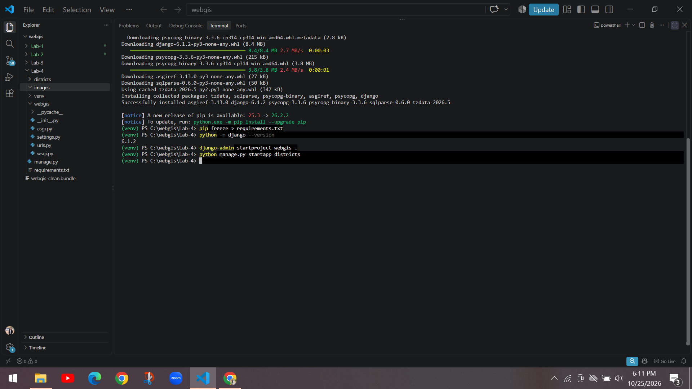

*`django-admin startproject webgis .` and `python manage.py startapp districts`. The `webgis` folder and `manage.py` appear in the Explorer.*

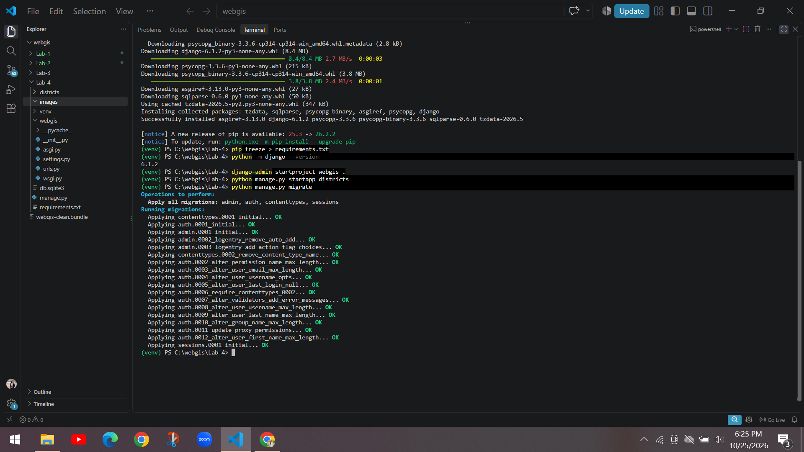

*The first `migrate` runs on the default SQLite database. Part 3 replaces it with PostGIS.*

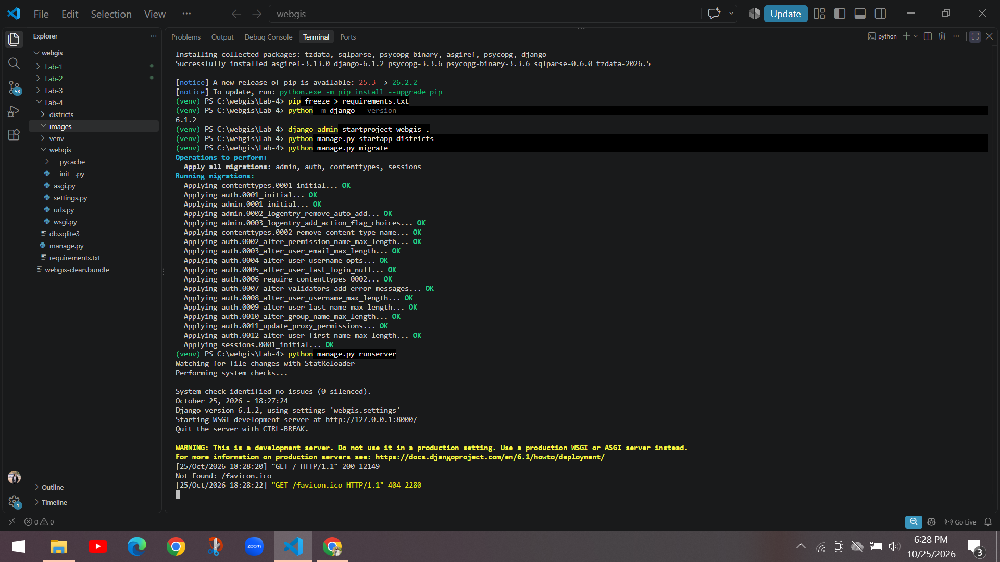

*`python manage.py runserver`: the system check finds no issues and the page is served at `127.0.0.1:8000`.*

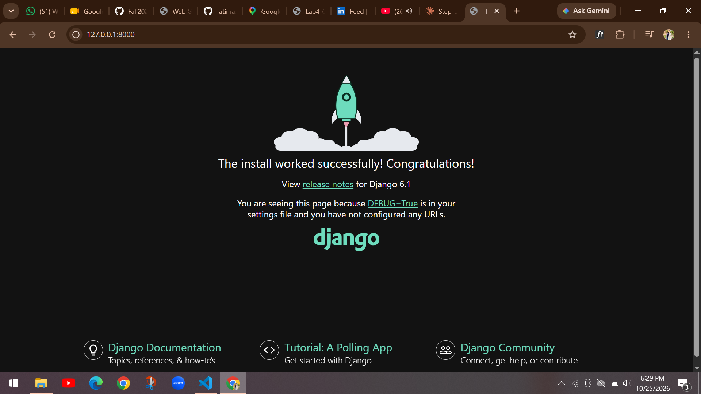

*The "install worked successfully" page, with the address bar visible.*

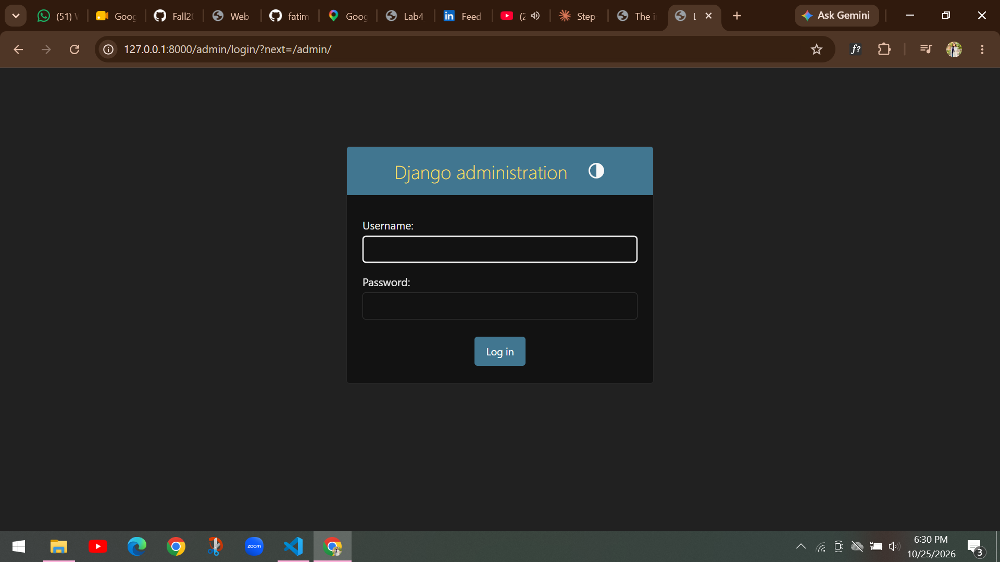

*`/admin/` shows the login page. There is no user yet.*

---

## 4. PostgreSQL and PostGIS (Checkpoint 2)

PostgreSQL 18 and PostGIS were installed. In pgAdmin, a database called `webgis` was created and the PostGIS extension was added.

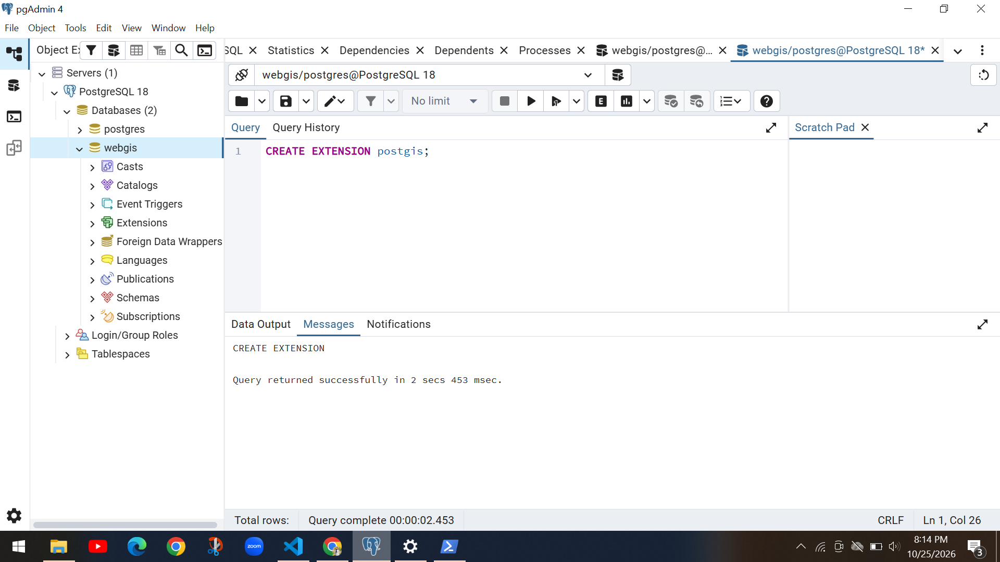

*`CREATE EXTENSION postgis;` in the `webgis` database: "Query returned successfully".*

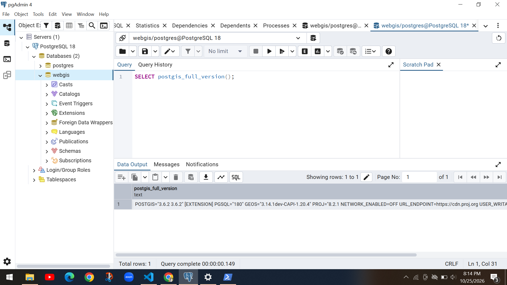

*`SELECT postgis_full_version();` returns `POSTGIS="3.6.2 3.6.2" ... PGSQL="180" GEOS="3.14.1dev-CAPI-1.20.4" PROJ="8.2.1 ..."`.*

---

## 5. Django connected to PostGIS (Checkpoint 3)

`settings.py` was edited to find OSGeo4W, add `django.contrib.gis` and `districts` to `INSTALLED_APPS`, and use the PostGIS database engine.

```text
python manage.py shell -c "from django.contrib.gis import gdal, geos; print(gdal.gdal_version(), geos.geos_version())"
b'3.13.3' b'3.15.0-CAPI-1.21.0'

python manage.py check
System check identified no issues (0 silenced).

python manage.py migrate
Applying contenttypes.0001_initial... OK   (all admin, auth and sessions migrations OK)
```

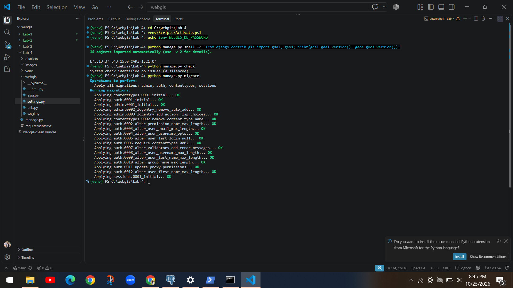

*GDAL and GEOS load, the settings check passes, and `migrate` logs in to PostGIS. (The password line in the terminal is blacked out.)*

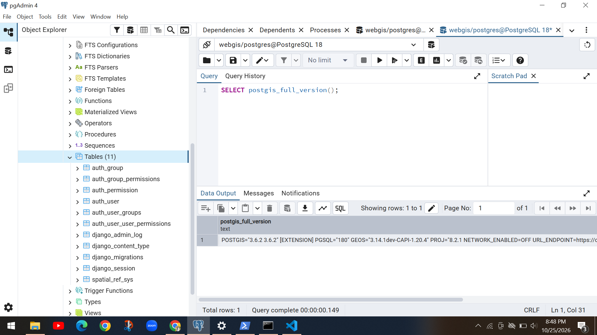

*pgAdmin, `public` schema, Tables (11): Django's tables plus `spatial_ref_sys` from PostGIS.*

---

## 6. A model with a geometry (Checkpoint 4)

The `District` model has a `MultiPolygonField(srid=4326)` for the shape.

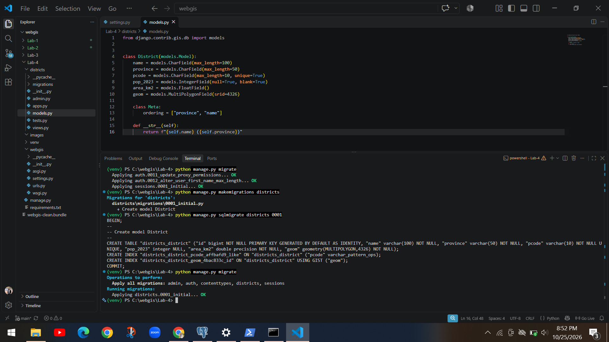

*`models.py`, then `makemigrations districts`, `sqlmigrate districts 0001` and `migrate`.*

Key lines of the SQL from `sqlmigrate`:

```sql
"geom" geometry(MULTIPOLYGON,4326) NOT NULL
CREATE INDEX "districts_district_geom_4bac833c_id" ON "districts_district" USING GIST ("geom");
```

The first line is a real PostGIS geometry column. The second is a spatial index that GeoDjango adds by itself.

Columns of `districts_district`, read back from PostgreSQL:

| Column | Type | Nullable |
|---|---|---|
| id | bigint | NO |
| name | varchar(100) | NO |
| province | varchar(50) | NO |
| pcode | varchar(10) | NO |
| pop_2023 | integer | YES |
| area_km2 | double precision | NO |
| geom | geometry (MultiPolygon, 4326) | NO |

---

## 7. Loading the districts (Checkpoint 5)

`data/districts.geojson` was copied into the project and `districts/load.py` loads it.

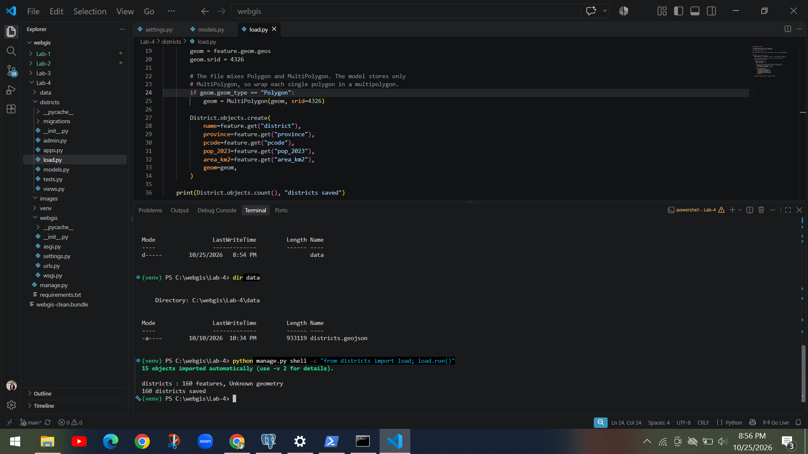

*Output: `districts : 160 features, Unknown geometry` and `160 districts saved`. The layer type is Unknown because the file mixes 152 Polygon and 8 MultiPolygon features.*

The seven lines typed in the Django shell:

| Line | Output |
|---|---|
| `District.objects.count()` | 160 |
| `District.objects.filter(province="Sindh").count()` | 29 |
| `District.objects.filter(pop_2023__isnull=True).count()` | 25 |
| `lahore = District.objects.get(name="Lahore")` | |
| `lahore.pop_2023` | 13004135 |
| `lahore.geom.geom_type` | `'MultiPolygon'` |
| `lahore.geom.num_coords` | 238 |

---

## 8. The admin panel (Checkpoint 6)

A superuser was created, the model was registered with `GISModelAdmin`, and the panel was explored at `/admin/`.

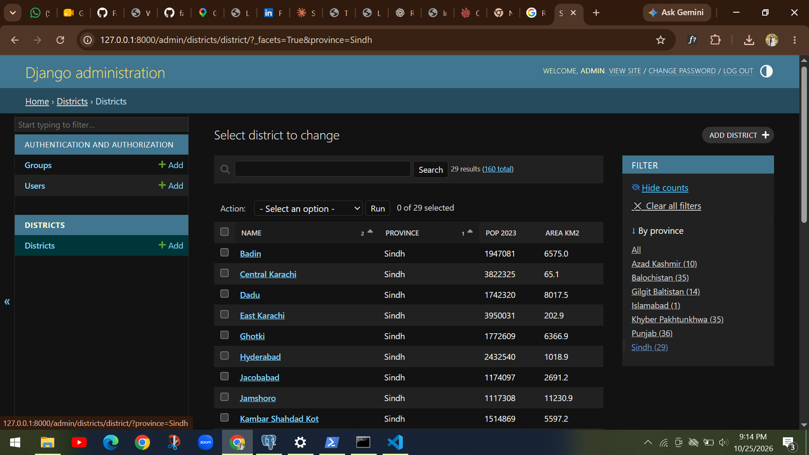

*Districts filtered by province: Sindh shows 29 results out of 160 total.*

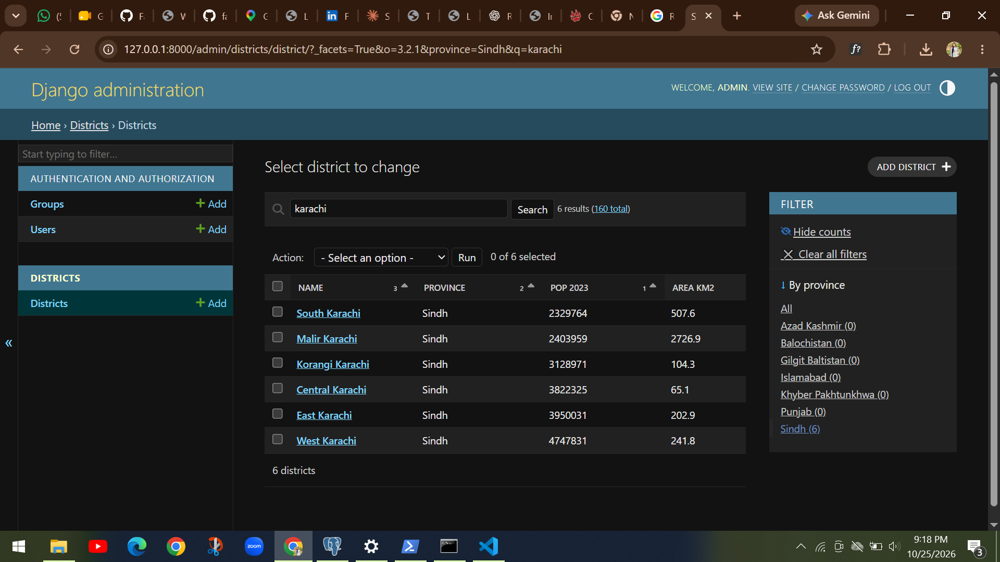

*Searching `karachi` inside Sindh gives 6 districts, from East Karachi to West Karachi.*

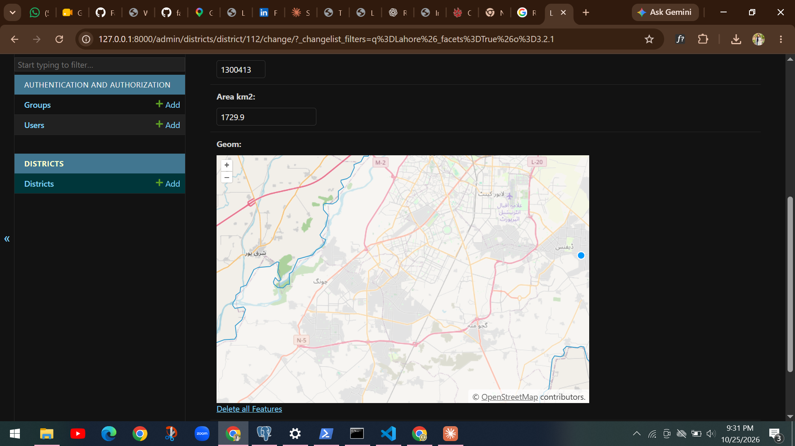

*Lahore's page. The geometry field is drawn by OpenLayers on an OpenStreetMap basemap.*

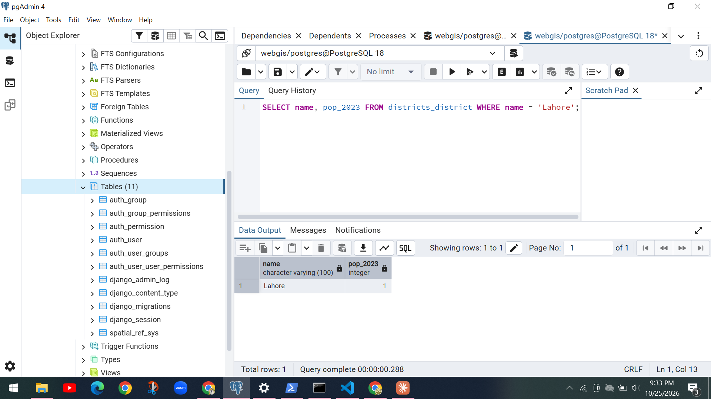

*After saving a new population in the admin, pgAdmin shows `pop_2023 = 1` for Lahore. The admin edited the real table.*

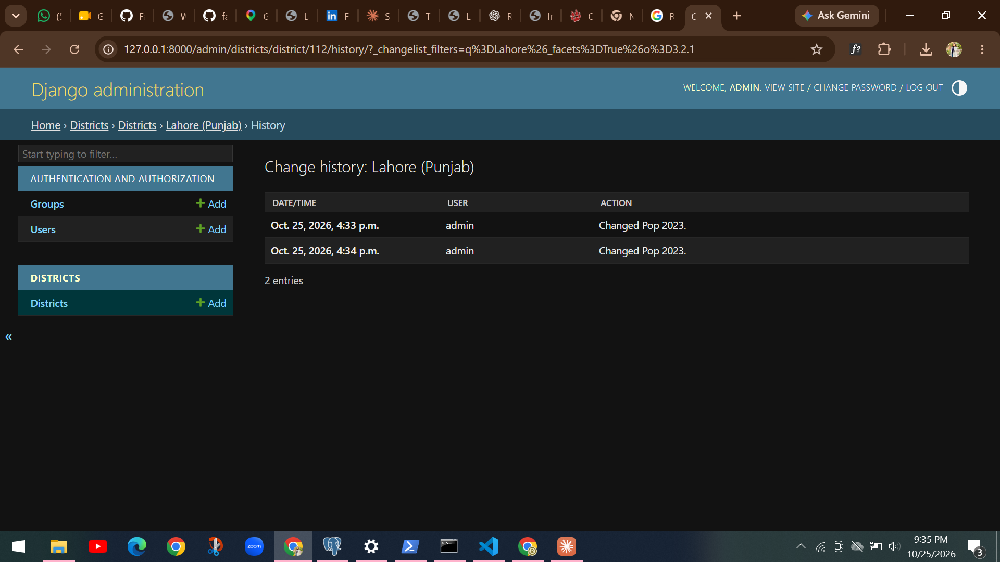

*History for Lahore: two changes by `admin`, the edit at 4:33 pm and the restore at 4:34 pm. The population is back to 13,004,135.*

---

## 9. Leaflet fed by Django (Checkpoint 7)

Two views and two URLs were added. `/` serves the map page and `/api/districts/` returns the districts as GeoJSON from PostGIS.

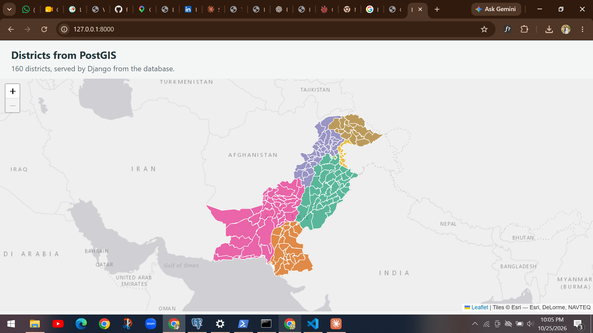

*`127.0.0.1:8000`: "160 districts, served by Django from the database", coloured by province.*

Size of the API responses, measured with `curl`:

| URL | Status | Size | Features |
|---|---|---|---|
| `/api/districts/` | 200 | 1,026,495 bytes (about 1 MB) | 160 |
| `/api/districts/?province=Sindh` | 200 | 173,769 bytes (about 170 KB) | 29 |

The tooltip (`Quetta, Balochistan`) is shown in the screenshot in section 10.

---

## 10. Extension: a spatial question (Checkpoint 8)

A third view, `/api/where/`, takes a point and PostGIS returns the district that contains it. Clicking the map calls it.

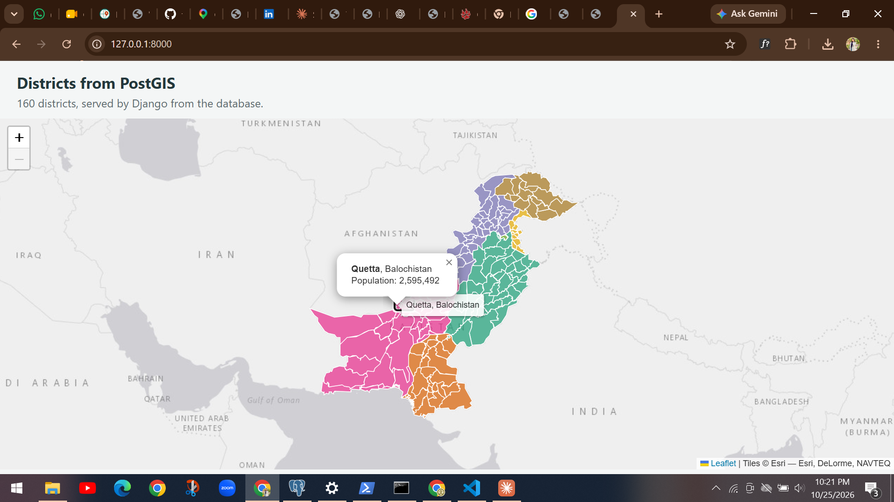

*Clicking the map near Quetta shows the popup "Quetta, Balochistan, Population: 2,595,492", with the hover tooltip beside it.*

Direct tests of the endpoint:

| URL | Result |
|---|---|
| `/api/where/?lat=33.6423&lng=72.9906` | `{"district": "Islamabad", "province": "Islamabad", "pop_2023": 2363863}` |
| `/api/where/?lat=24.0&lng=66.0` (sea) | `{"district": null}` |
| `/api/where/` | 400, "give lat and lng as numbers" |

The same question in SQL, with `ST_Contains` on the NUST point, also returns Islamabad.

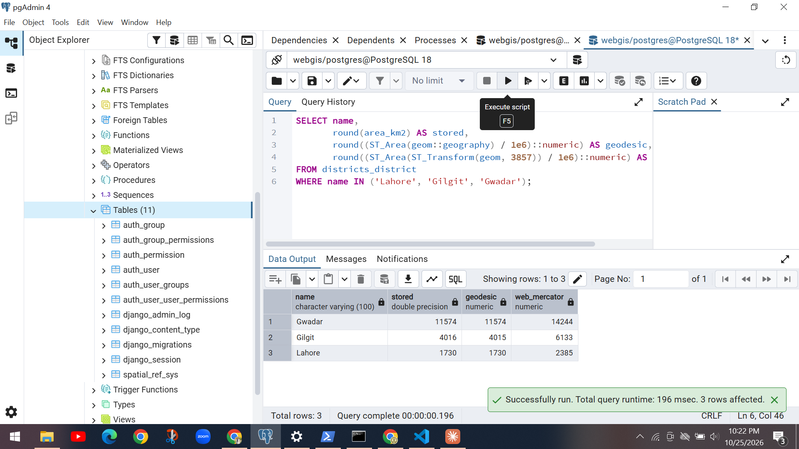

*The area query in pgAdmin.*

| District | Stored (km²) | Geodesic (km²) | Web Mercator (km²) | Mercator / geodesic |
|---|---|---|---|---|
| Gwadar (about 25°N) | 11574 | 11574 | 14244 | 1.23 |
| Lahore (about 31.5°N) | 1730 | 1730 | 2385 | 1.38 |
| Gilgit (about 36°N) | 4016 | 4015 | 6133 | 1.53 |

The stored area matches the geodesic area. Web Mercator inflates area by about 1 / cos²(latitude), so the error grows towards the north.

---

## 11. Questions

**1. In Labs 2 and 3, every visitor downloaded the whole GeoJSON file. What can a page backed by Django and PostGIS do instead? Give two examples from this lab.**

It can send only what is asked for, and let the database do the work. First, `/api/districts/?province=Sindh` returns 29 districts (about 170 KB) instead of all 160 (about 1 MB). Second, `/api/where/` answers "which district is this point in?" with a reply of 71 bytes, using `ST_Contains` in PostGIS instead of the browser testing 160 polygons.

**2. Why does `settings.py` read the database password from an environment variable, instead of containing the password itself?**

`settings.py` is committed to GitHub, so a password written in it would be public and would stay in the history. The environment variable lives only on my machine, and anyone who clones the project can use their own password.

**3. In Part 4, the SQL ends with an index created USING GIST. What does it do, and which query in this lab benefits from it?**

A GiST index is a spatial index. It stores the bounding box of each geometry in a tree, so PostGIS can skip every district whose box cannot contain the point. The `geom__contains` (`ST_Contains`) query behind `/api/where/` benefits. Without the index, every click would test all 160 polygons.

**4. The loading script wraps some geometries in a MultiPolygon. What would happen without that step, and why?**

The column is `geometry(MULTIPOLYGON,4326)`, so PostGIS would reject a plain Polygon. 152 of the 160 features are Polygons, so most inserts would fail. Wrapping a Polygon in a MultiPolygon with one part changes nothing on the map.

**5. Who should have an admin login for a district dataset like this, and who should not?**

Only the few trusted people who maintain the data, such as a GIS officer, ideally with limited rights like change but not delete. The public, students and casual viewers should not have one, because anyone who can log in can change or delete every row.

**6. Leaflet takes [lat, lng] and Point takes (lng, lat). Where in this lab is each order used, and how does the extension's URL avoid confusing them?**

Leaflet uses `[lat, lng]` in `setView([30.3753, 69.3451])`, in `maxBounds`, and in `e.latlng.lat` and `e.latlng.lng` in the click handler of `map.html`. GEOS `Point` uses `(lng, lat)` in `Point(lng, lat, srid=4326)` inside `views.district_at`. The URL uses named parameters, `?lat=...&lng=...`, and the view reads each one by name before building the Point, so the order in the URL cannot be mixed up.

---

## 12. Submission links

| Repository | https://github.com/fatimazaheer602-source/webgis-2025-IGIS-537812 |
|---|---|
| Lab 4 folder | https://github.com/fatimazaheer602-source/webgis-2025-IGIS-537812/tree/main/lab-4 |
| Live page (Lab 4) | None. GitHub Pages only serves files and cannot run Python or a database, so this lab runs only on my own machine. |
| Live page (Lab 1) | https://fatimazaheer602-source.github.io/webgis-2025-IGIS-537812/lab-1/ |
| Live page (Lab 2) | https://fatimazaheer602-source.github.io/webgis-2025-IGIS-537812/lab-2/ |
| Live page (Lab 3) | https://fatimazaheer602-source.github.io/webgis-2025-IGIS-537812/lab-3/ |
