# Web GIS Lab 5: A spatial API

**Submitted To:** Shahid Nawaz  
**Submitted By:** Fatimah Zaheer  
**Reg no:** 537812  
**Subject:** WebGIS

Lab 5 continues the Lab 4 project: same database, same 160 districts, in a new folder with a new virtual environment.

## Versions

```
asgiref==3.13.0
Django==6.1.2
django-filter==26.2
djangorestframework==3.18.3
djangorestframework-gis==1.3.0
psycopg==3.3.6
psycopg-binary==3.3.6
sqlparse==0.6.0
tzdata==2026.5
```

Python 3.14.3, PostgreSQL 18.1, PostGIS 3.6.2. The handout says djangorestframework-gis 1.3 is not certified for Django 6.1 or Python 3.14. It installed and worked for every part.

## Problems

| Problem | Fix |
|---|---|
| `robocopy` said `Invalid Parameter #3` | Wrong path where an option belongs. Used `robocopy C:\webgis\Lab-4 C:\webgis\Lab-5 /E /XD venv __pycache__` |
| `Activate.ps1` not found in Lab-5 | `/XD venv` leaves the environment out. Ran `python -m venv venv` and `pip install -r requirements.txt` |
| Map tiles grey, "Access blocked, 403" | Django's default referrer policy hid the Referer from OpenStreetMap. Added `SECURE_REFERRER_POLICY = "strict-origin-when-cross-origin"` |
| Forgot the admin password | Django stores only a hash. Reset it with `set_password` in the shell |

## 1. Setup (Checkpoint 1)

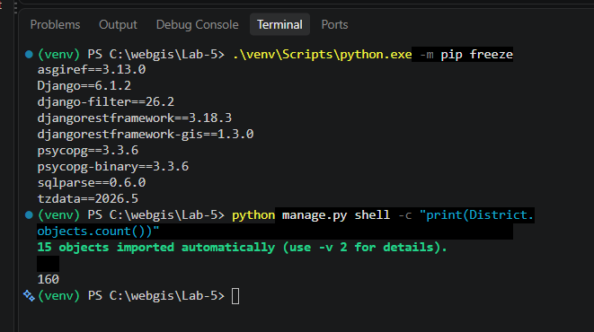

The count is 160 because Lab 5 uses the same `webgis` database. Nothing was reloaded.

## 2. First API (Checkpoint 2)

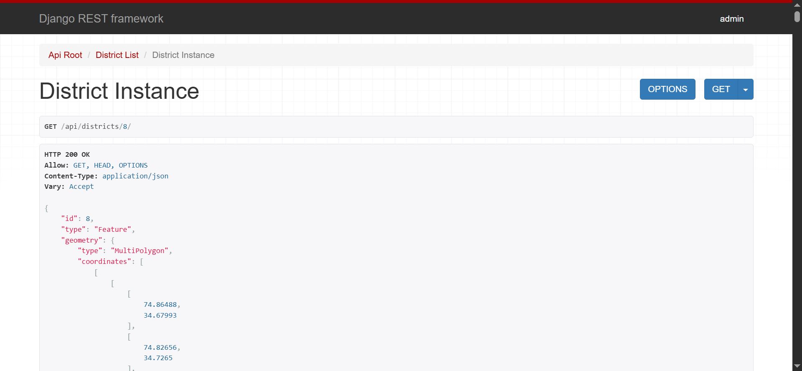

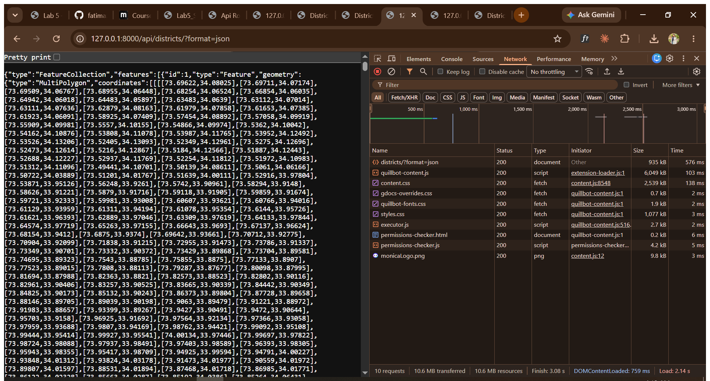

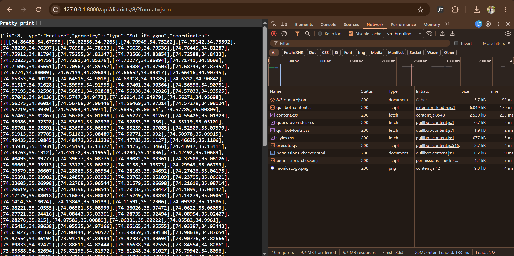

## 3. Loading by view (Checkpoint 3)

`?province=Sindh` returns 29 districts. `?in_bbox=74.0,31.2,74.7,31.8` returns 4 (Kasur, Lahore, Nankana Sahib, Sheikhupura).

| View | Districts | Size |
|---|---|---|
| `/api/districts/?format=json`, everything | 160 | 935 kB |
| Map as it opens, zoom 9 | 20 | 99.3 kB |
| Zoomed out to zoom 6 | 124 | 722 kB |
| Lahore, zoom 11 | 2 | 14.3 kB |

The map rows depend on window size (mine was about 980 px wide, with DevTools open).

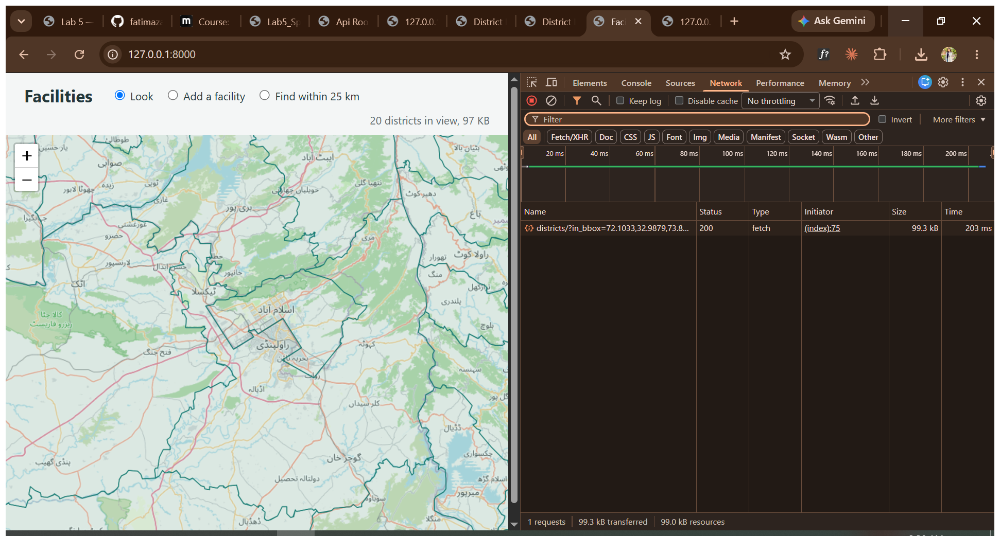

## 4. Facilities (Checkpoint 4)

```sql
"geom" geometry(POINT,4326) NOT NULL
CREATE INDEX "facilities_facility_geom_ba199118_id" ON "facilities_facility" USING GIST ("geom");
```

The districts table is `MULTIPOLYGON`, this one is `POINT`. Same SRID, and GeoDjango adds the GiST index on both without being asked.

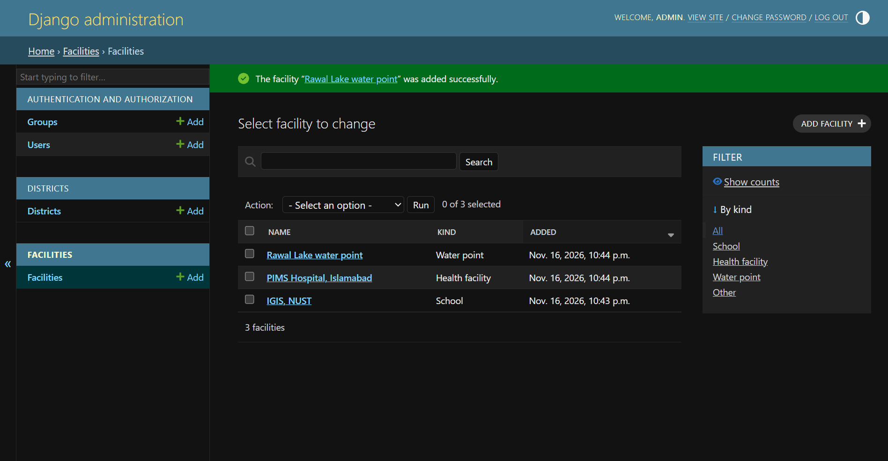

## 5. Accepting points (Checkpoint 5)

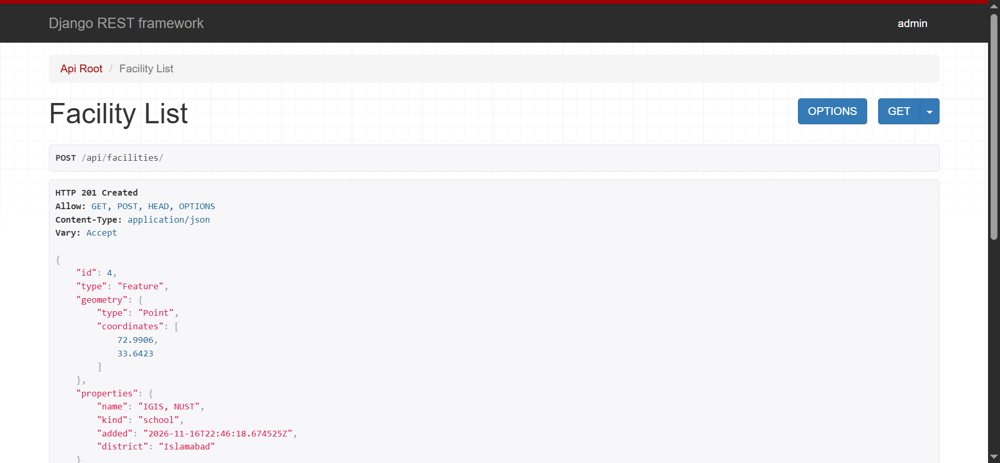

| Test | Answer |
|---|---|
| `[64.0, 23.0]`, Arabian Sea | `400`: `{"geom": ["This point is not inside any district of Pakistan."]}` |
| `"kind": "castle"` | `400`: `{"kind": ["\"castle\" is not a valid choice."]}` |
| `[33.6423, 72.9906]`, swapped | `400`: `{"geom": ["This point is not inside any district of Pakistan."]}` |

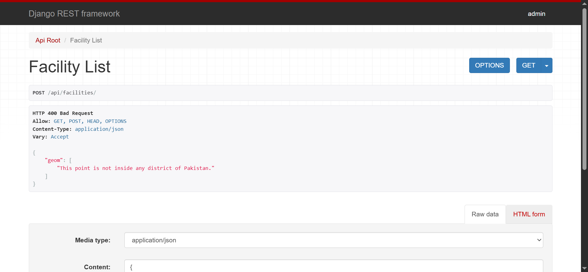
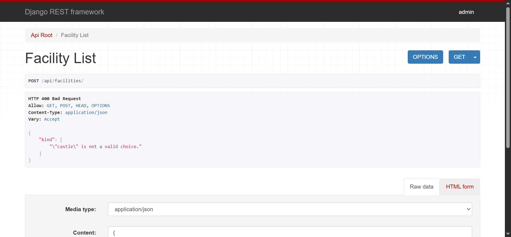


The swapped point gets the same message as the sea. The check only asks whether the point falls inside a district, so it catches both.

## 6. Adding facilities from the map (Checkpoint 6)

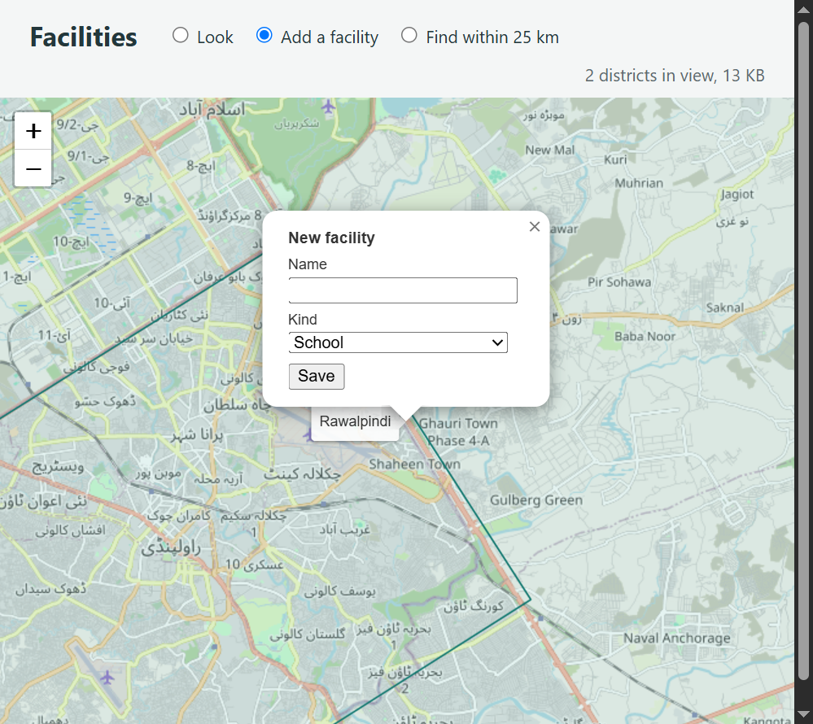

1. **Arabian Sea.** The form stayed open with "This point is not inside any district of Pakistan." Nothing was saved.
   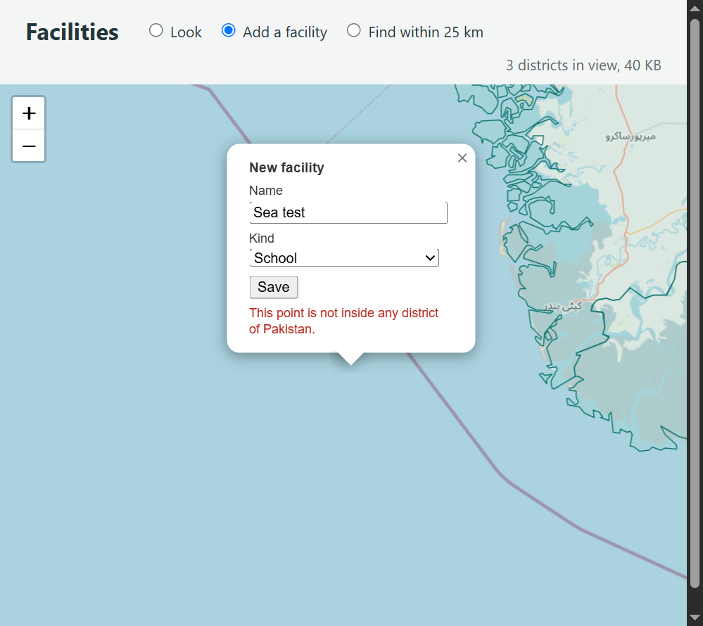
2. **Name ` Test`.** Saved. In Look mode the popup shows it as plain text.
   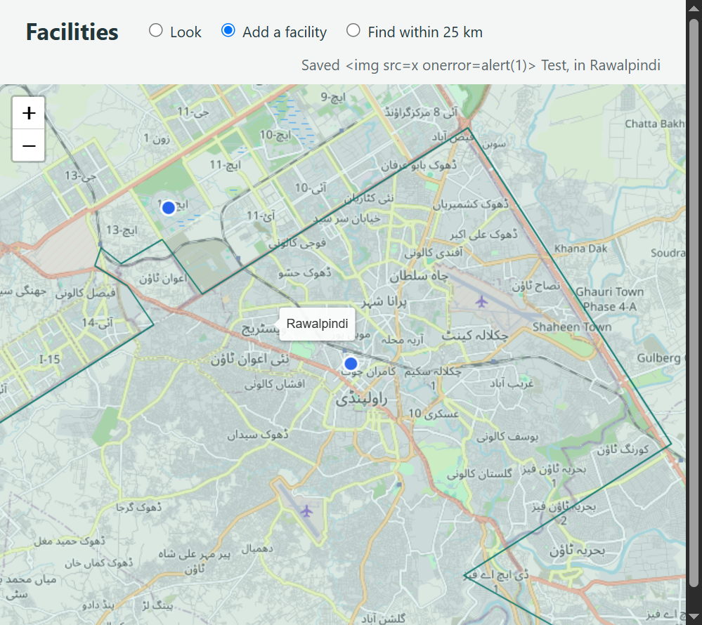
   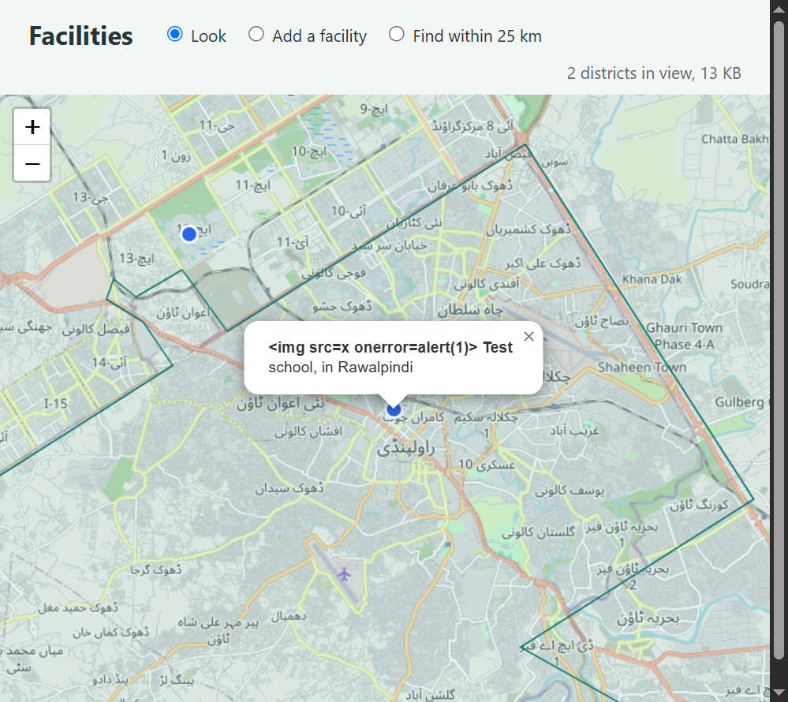
3. **`escapeHtml(p.name)` changed to `p.name`.** The popup created the image, `onerror` ran and an alert appeared. I did not capture the dialog. `escapeHtml` was put back.
4. **CSRF while logged in to the admin.** With the header the facility saved.
   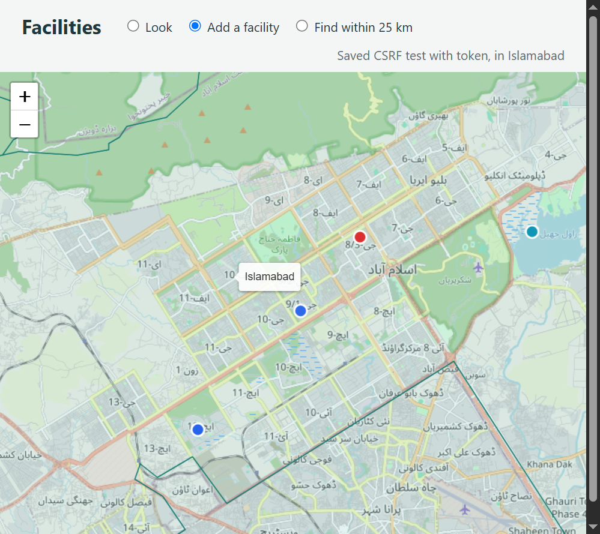
   Without the `X-CSRFToken` line it failed with `CSRF Failed: CSRF token missing.` The line was put back.
   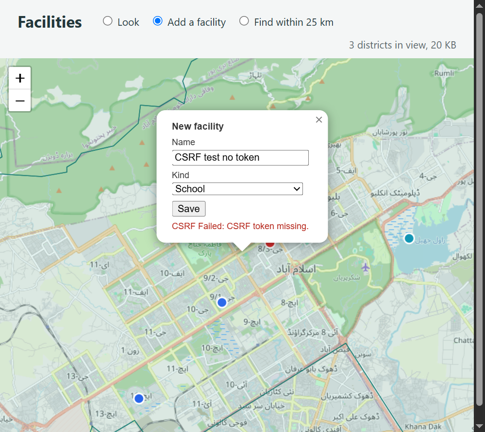

## 7. Within 25 km (Checkpoint 7)

`DistanceToPointFilter` added. A search near NUST returned six facilities, matching an independent distance check in the shell.

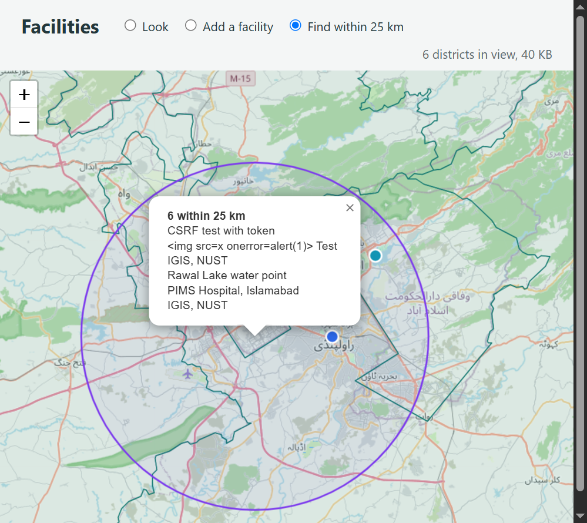

## Questions

**1. Why does loading by view save so much at zoom 9 and so little at zoom 6?**   
At zoom 9 only 20 of 160 districts are sent, 99.3 kB instead of 935 kB. At zoom 6 the view covers most of the country, so 124 are sent and the saving is small. For the whole country, simplify geometries at low zoom or use vector tiles, and turn on gzip.

**2. District is worked out each time. One advantage, one cost?**   
Advantage: it never goes out of date if a boundary changes. Cost: a spatial query for every facility on every request, which slows down as the table grows.

**3. The map blocks sea clicks, so why must the server check?**   
Any client can call the API without the map (curl, a script, the browsable API). The server is the only place under my control.

**4. Why did posting fail only after logging in to the admin?**   
DRF checks CSRF only for requests with a session cookie. Anonymous requests have none. After the admin login the cookie was sent, and the request had no token.

**5. What happened in step 3 of Part 6.4, and who is affected?**   
The name was inserted as raw HTML, so the `onerror` code ran. That is cross-site scripting. On a real site it runs for everyone who opens the popup.

**6. What must exist before DELETE is safe?**   
Logins and permission rules for who may delete what (Lab 6), plus a record of who added each facility and a history so deletes can be undone.

## Submission

Repository: https://github.com/fatimazaheer602-source/webgis-2025-IGIS-537812 (folder `lab-5`)
